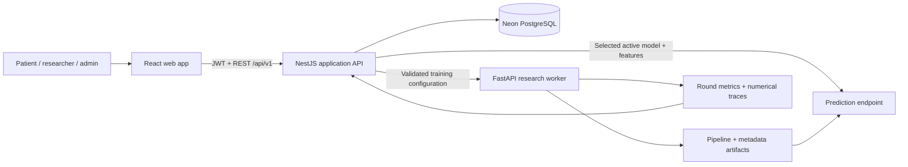
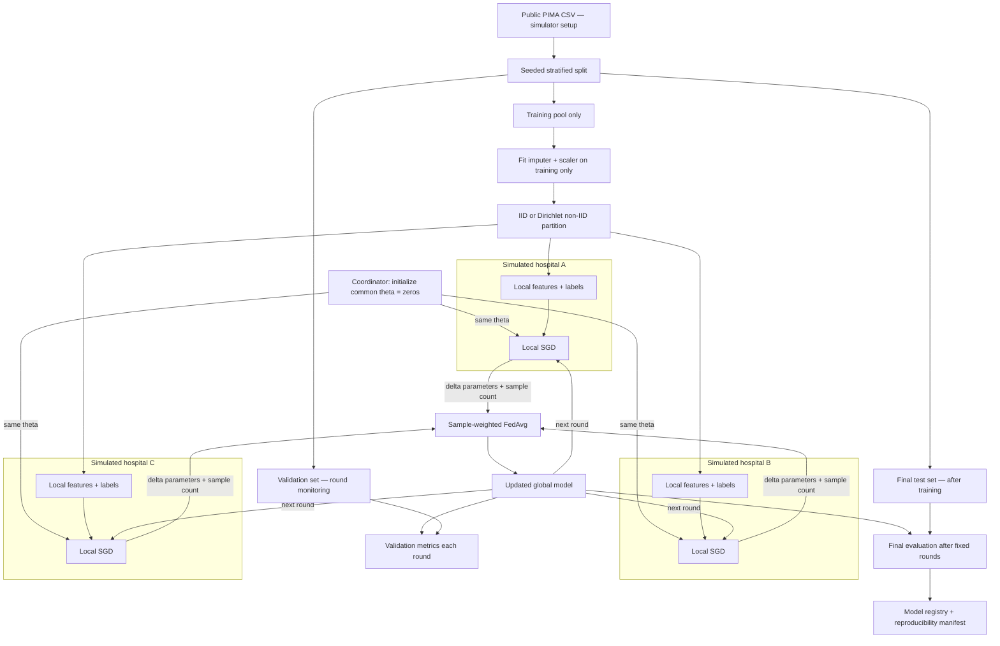

# FedHealth architecture — implemented research simulator

Updated 20 November 2026. This document describes the code that runs, with simulation assumptions stated explicitly.

## The question this architecture answers

**How can an untrained model learn from hospitals without the aggregator receiving patient records?**

A model is a parameterized rule, not a dataset. FedHealth uses logistic regression:

`p(y=1 | x) = sigmoid(w · x + b)`

There are eight feature coefficients and one bias. At round zero, every coefficient and the bias are zero, so the probability is 0.5 for any input. The coordinator can initialize these nine numbers without seeing any patients. Every hospital receives the same starting vector; local SGD changes it using that hospital's feature rows and known labels.

## Application components



NestJS owns authentication, roles, experiment records, model activation and prediction history. FastAPI owns dataset validation, training and inference. PostgreSQL stores application metadata and results. Model pipelines live on the ML service filesystem; a deployed instance therefore needs persistent storage. Model activation verifies that the ML service lists both the metadata and pipeline before changing the active model. If files are missing or the worker is unreachable, the existing activation is preserved. Raw CSV uploads live in `data/uploads/`, not in PostgreSQL.

Training is currently dispatched by the API in the background and executed through a synchronous HTTP request to the ML service. FastAPI runs the CPU-bound route in its thread pool, keeping its event loop available. This is **not a durable job queue**: an API restart can lose job completion handling, and an app cancellation does not terminate an in-flight Python calculation. Persistent job claiming, restart recovery and cooperative cancellation remain deployment work.

## Learning architecture and boundaries



The boxes are **logical boundaries within one process**, not separate hospital servers. The simulator loads a public CSV and fits shared imputation/scaling statistics on its pooled training split. It then partitions training rows and calls each local trainer. This controls the numerical experiment but does not demonstrate network isolation or fully decentralized preprocessing. A real hospital deployment would require site-owned data, authenticated client communication and agreed or federated preprocessing statistics.

## One round, precisely

1. Coordinator broadcasts the same `theta_t = [w_1, ..., w_8, b]` to every client.
2. Client k uses only its local `X_k, y_k` for the configured mini-batch SGD steps.
3. It computes `delta_k = theta_k - theta_t`.
4. Optionally, the simulator clips and noises the delta before aggregation.
5. The server receives `ClientUpdate(client_id, num_samples, delta)`.
6. For `N = sum(n_k)`, compute `theta_(t+1) = theta_t + sum((n_k / N) * delta_k)`.
7. Monitor the global model on validation data and repeat from the new global parameters.
8. After the configured rounds, evaluate on test data and persist the model pipeline and metadata.

`aggregation_service.py` accepts only parameter vectors, client identifiers and sample counts. It rejects empty updates, duplicate clients, nonpositive counts, shape mismatches and nonfinite values. It does not accept feature matrices or outcome vectors. Local training and orchestration are in `federated_service.py`.

### Illustrative payload (not measured results)

```json
{
  "round_number": 1,
  "client_id": 0,
  "num_samples": 100,
  "delta": [0, 0.2, 0, 0, 0, 0, 0, 0, -0.1]
}
```

Order: Pregnancies, Glucose, BloodPressure, SkinThickness, Insulin, BMI, DiabetesPedigreeFunction, Age, bias. The payload carries learned changes; it carries no patient rows. Counts and diagnostic summaries are metadata, so do not claim that the entire platform shares absolutely no information about local data.

For an illustrative Glucose update of 0.2, 0.5, 0.8 from hospitals with 100, 200, 300 rows, starting at zero:

`new_weight = 0 + (100/600 × 0.2) + (200/600 × 0.5) + (300/600 × 0.8) = 0.6`

This equals averaging the locally learned parameters because all clients started from the same global vector. Averaging unrelated classifiers with different features/scalers or averaging prediction probabilities is not this implementation of FedAvg.

## Inspectable evidence in the app

`How it works` is now an architecture lab. It works before any experiment exists using a clearly labeled example. A fresh completed FedAvg experiment exposes every round's starting global vector, sent client deltas, sample counts, weighted delta and resulting global vector. The browser recomputes all nine resulting parameters independently from counts and deltas, then reports maximum absolute error. Export the JSON trace to use in the viva.

Actual traces are stored under `experiment_rounds.evalMetrics.federation_trace`; no database schema change is needed. Existing runs have no trace and are labeled legacy. Under noisy training, only the sent clipped/noisy deltas appear in the trace; unnoised local parameter vectors are not added to it.

## Evaluation protocol v2

All methods use `evaluation_service.make_evaluation_split` with the same dataset and seed:

- Hold out 20% for final testing (configurable test fraction).
- Hold out 20% of the remaining development pool for validation.
- Fit preprocessing and train clients on the remaining rows only.
- At defaults on 768 rows: **491 training / 123 validation / 154 test**.
- Round curves measure validation performance; final metric cards measure test performance.
- Persist split counts and SHA-256 hashes of sorted positional indices for comparison, without exporting records or row IDs.

Protocol identifier: `stratified_train_validation_test_v2`. Historic two-way splits used 614 training / 154 test and evaluated test every round. Preserve those runs for history, but regenerate final results under v2. The Compare page warns on incompatible dataset/seed/balancing/protocol/split combinations and suppresses automatic claims for them.

Centralized uses sklearn L-BFGS logistic regression; clients use hand-written SGD with a small L2 penalty. Optimizer and regularization differences are a comparison limitation. Local-only reports the mean across independently trained clients, not an ensemble. Its confusion matrix sums client evaluations on the same test records. Communication counts represent float64 parameter vectors only, excluding JSON, sample counts, metrics, traces and network overhead.

## Privacy and validity

Parameter sharing reduces raw-record sharing at the aggregation boundary. It does not prove that updates cannot leak information. The optional Gaussian noise mechanism is an educational experiment: noise is seeded, preprocessing is pooled, sample counts and diagnostics are visible, and sensitivity/accounting have not been certified. Report nominal epsilon/delta settings without claiming patient-level DP, secure aggregation, encryption of individual updates or regulatory compliance.

Predictions are research estimates on a small public dataset. No clinical validation is established.

## Code map

| Responsibility | Source |
|---|---|
| Local training, partitioning and orchestration | `backend/ml-service/app/services/federated_service.py` |
| Data-free aggregation contract and trace | `backend/ml-service/app/services/aggregation_service.py` |
| Shared split protocol and manifest | `backend/ml-service/app/services/evaluation_service.py` |
| Centralized baseline | `backend/ml-service/app/services/training_service.py` |
| Persist experiment and round results | `backend/api/src/modules/experiments/experiments.service.ts` |
| Architecture lab | `frontend/src/features/how-it-works/HowItWorksPage.tsx` |
| Independent browser reconstruction | `frontend/src/components/FederationRoundInspector.tsx` |
| Repeatable multi-seed benchmark | `scripts/run_research_benchmark.py` |

## References

- [McMahan et al., FedAvg, AISTATS 2017](https://proceedings.mlr.press/v54/mcmahan17a.html): common model initialization, local updates and sample-weighted model averaging.
- [scikit-learn: common pitfalls](https://scikit-learn.org/stable/common_pitfalls.html): fit preprocessing on training data and avoid evaluation leakage.
- [Zhu et al., Deep Leakage from Gradients, 2019](https://arxiv.org/abs/1906.08935): shared updates can expose information; excluding records does not by itself establish privacy.
